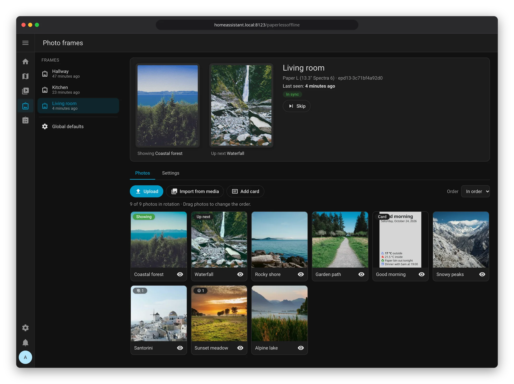
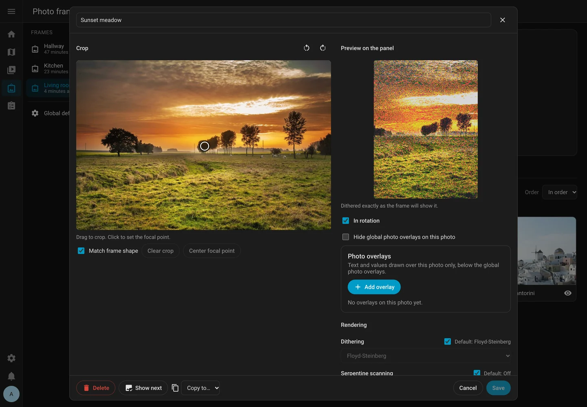
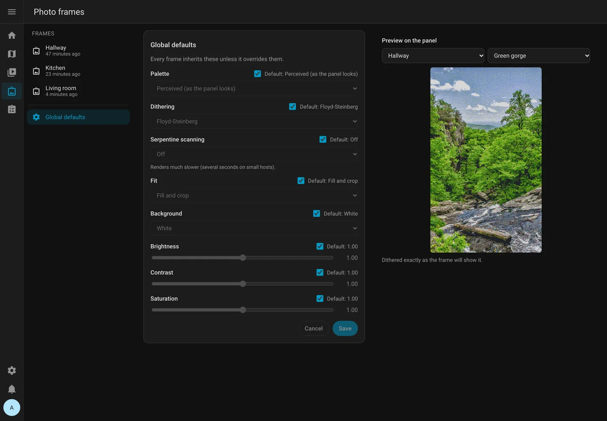

# paperlesspaper (offline firmware) for Home Assistant

Run your [paperlesspaper](https://paperlesspaper.de) e-paper photo frames from
Home Assistant. Each frame gets its own photo library and slideshow, which you
manage from a sidebar panel, a dashboard card or automations. You can also
put live text on top of the photos, such as the weather or a sensor value.

This integration is for frames running the
[offline firmware](https://github.com/paperlesspaper/paperlesspaper-firmware-offline).
For telemetry on wake, use the fork
[FWeinb/paperlesspaper-firmware-offline](https://github.com/FWeinb/paperlesspaper-firmware-offline).



## Screenshots

<table>
  <tr>
    <td width="50%"></td>
    <td width="50%"></td>
  </tr>
  <tr>
    <td align="center"><b>Photo editor:</b> crop, focal point, overlays and a live preview of the dithered result</td>
    <td align="center"><b>Global defaults:</b> the default look for every frame, previewed on any frame's photo</td>
  </tr>
</table>

## Requirements

- Home Assistant 2026.1.0 or newer.
- A paperlesspaper frame running the offline firmware.
- Recommended: a Bluetooth adapter or an ESPHome Bluetooth proxy near the
  frame. It makes setup easier and lets you push changes instantly.

## Installation

**With HACS (recommended).**

1. In HACS, add `https://github.com/FWeinb/ha-paperlesspaper-offline` as a
   custom repository (category *Integration*).
2. Install **paperlesspaper (offline firmware)** and restart Home Assistant.

**Manually.**

1. Download `paperlessoffline.zip` from the latest
   [release](https://github.com/FWeinb/ha-paperlesspaper-offline/releases).
2. Extract it into `config/custom_components/paperlessoffline/`.
3. Restart Home Assistant.

Install from a release, not from a copy of the repository: the panel and card
are only included in the release zip.

Then check that Home Assistant has a local network URL (*Settings → System →
Network*). The frame must reach it over plain HTTP.

## Adding a frame

**Over Bluetooth (recommended).**

1. Press the frame's button **once**. It stays in setup mode for about 30
   seconds.
2. Home Assistant discovers the frame and offers to set it up. Confirm.
3. For a new frame, open **WiFi (optional)** and enter your network. Home
   Assistant checks that the frame really connects before finishing.

If setup times out, press the button again and retry.

**Manually.**

1. Add the integration and enter the frame ID shown on its screen, e.g.
   `epd7-3485188f1dc8`.
2. Copy the *Settings URL* and *Image URL* that Home Assistant shows.
3. Enter both in the official
   [web UI](https://paperlesspaper.github.io/paperlesspaper-firmware-offline/).

**Several networks?** If Home Assistant is reachable on more than one address
(e.g. a separate IoT VLAN), choose the one the frame should use during setup,
or later under *Address the frame uses* in the frame's options. Pick
*Automatic*, one of the listed IPs, or type an IP or hostname the frame can
resolve. Then press the frame's button once so it gets the new address over
Bluetooth (or follow the repair notice).

## Good to know: changes apply on the next wake

The frame sleeps most of the time and only wakes on its refresh interval, a
button press or (optionally) motion. Anything you change in Home Assistant,
whether a new photo or a setting, shows up at the frame's **next wake**.

- **Show it now:** press the frame's button **twice** to make it wake and
  fetch the current photo.
- **Apply settings now:** press the button **once**. With Bluetooth in range,
  Home Assistant sends pending changes straight away and refreshes the battery
  reading.
- **Is it up to date?** The *In sync* binary sensor is off, and *Pending
  changes* lists what is waiting, until the frame has picked everything up.

## Managing photos

Admins get a **Photo frames** entry in the sidebar.

**Each frame's page** shows what the frame displays now and what's up next,
when it was last seen, and whether it is in sync. *Skip* moves on to the next
photo.

**Photos tab**
- **Add photos** by drag-and-drop or *Upload* (JPEG, PNG, WebP, HEIC; up to
  50 MB and 100 megapixels each), or *Import from media* to pick from any Home
  Assistant media source.
- **Order** by dragging. Choose *In order* or *Shuffle* (no repeats until all
  photos have been shown).
- **Pause a photo** with the eye button to take it out of the rotation without
  deleting it.
- **Edit a photo** by clicking it:
  - drag to **crop** (locked to the frame's shape by default);
  - click to set the **focal point**, the part kept when cropping to fill;
  - **rotate** in 90° steps;
  - adjust **dithering, serpentine, fit, background, brightness, contrast
    and saturation** for this photo only;
  - check the **live preview**, which shows exactly what the frame will show;
  - *Show next*, *Copy to…* another frame, or *Delete*.

**Settings tab:** mounting, refresh interval and the frame's default look,
with a preview.

**Global defaults** (panel sidebar): the default look for every frame.

Settings are layered: a photo's own setting wins over the frame default, which
wins over the global default. Every field shows what it would inherit.

The panel follows your Home Assistant theme and language (English and German).

## Dashboard card

Add the **paperlesspaper frame** card from the card picker and choose a frame.
It shows the current photo (and optionally what's up next), the sync state,
a *Skip* button and, for admins, a link to the panel.

```yaml
type: custom:paperlessoffline-frame-card
device_id: 0123456789abcdef   # the frame's device
show_up_next: true
title: Kitchen                # optional
```

## Text overlays

Overlays are text boxes drawn sharply on top of photos: the weather, a sensor
value, the date or a caption.

- **Global photo overlays** appear on every photo of a frame. Edit them in the
  panel: *Settings* tab, section *Global photo overlays*.
- **Photo overlays** appear on one photo only. Edit them in the photo editor,
  section *Photo overlays*. To hide the global ones on a photo, tick *Hide
  global photo overlays on this photo*.

Both have a live preview with current values.

**Copying overlays.** In the photo editor, *Copy to photos…* in the *Photo
overlays* section copies that photo's overlays to the photos you pick (the
copies get new IDs, and you can choose to replace the existing ones). The same
works from automations with `copy_overlays`, `photo_id` and `to_photo_ids`.

**One-off images.** Global photo overlays are drawn on images from
`show_image` too. Set `overlays: false` to show an image bare.

**Writing the text.** The text is markdown with Home Assistant templates, with
autocompletion for entity IDs and icons:

- `# Heading`, `**bold**`, `*italic*`, `- list item` and line breaks
- colours: `{red}…{/red}` (black, white, red, green, blue, yellow)
- icons: `:mdi:weather-sunny:` (any Material Design Icon)
- `weather_icon(state)`: the icon for a weather condition
- `entity_icon(entity_id)`: the icon set on an entity
- `date_local(value, preset)`: a date in your language; presets `short`,
  `long`, `month_year`, `weekday`, `time`
- `frame.name` and `photo.name` (`photo` is `None` on one-off images, so
  `` works)
- `photo.date`: when the photo was taken, from its EXIF data. Use it with
  `date_local`, for example `{{ date_local(photo.date, 'long') }}`. It shows
  the clock time of the camera, using the photo's UTC offset when it has one
  and your Home Assistant time zone otherwise.
- `photo.location`: where the photo was taken, from its EXIF GPS data, with
  `latitude`, `longitude` and `altitude`. On its own it prints as
  `48.1372, 11.5756`, and it works with `distance()`, for example
  `{{ distance(photo.location, states.zone.home) | round }} km`.

Photos without that EXIF data have `photo.date` and `photo.location` set to
`None`, so guard them with ``. Both are read once
when a photo is added, and when you update from an older version. The
location is included in the `list_photos` result and left out of diagnostics.

```text
:mdi:thermometer: **{{ states('sensor.outdoor_temperature') }} °C**
{{ weather_icon(states('weather.home')) }} {{ state_attr('weather.home', 'temperature') }} °
{{ date_local(now(), 'long') }}
```

**Other options per overlay**
- **Placement**: one of nine positions, size S to XL, width (fit to text or a
  percentage) and alignment.
- **Behind the text**: a coloured box, an outline around the letters, or
  nothing.
- **Show if**: a template; the overlay only appears when it is truthy.
- **Update**: on every wake when the text changed (default), or only when the
  photo changes. The second avoids extra screen refreshes for values that
  change all the time.

Values are read when the frame wakes, so they are as fresh as the last wake.
If a template is broken, only that overlay is left out and the panel shows the
error.

## Automations

### Actions

Every action takes `config_entry_id`, which selects the frame.

| Action | What it does |
|---|---|
| `paperlessoffline.add_photo` | Add an image from **one** of `file_path`, `url`, `media_content_id` or `image_entity_id` (camera or image entity). Optional `name`, `enabled` and photo settings. Returns the `photo_id`. |
| `paperlessoffline.update_photo` | Change `name`, `enabled` or photo settings; `reset` clears settings (`all` clears every one). |
| `paperlessoffline.remove_photo` / `move_photo` / `copy_photo` | Manage the library; `copy_photo` copies to another frame. |
| `paperlessoffline.show_photo` / `next_photo` | Choose or skip the photo for the next wake. |
| `paperlessoffline.show_image` / `clear_image` | Show a one-off image for `wakes` wakes, or until `clear_image`, without adding it to the library. Set `overlays: false` to leave the frame's overlays off it. |
| `paperlessoffline.list_photos` | Return the library and what's up next. |
| `paperlessoffline.set_defaults` | Set the global defaults. |
| `paperlessoffline.add_overlay` / `update_overlay` / `remove_overlay` / `move_overlay` | Manage overlays. Pass `photo_id` for a photo's overlays, leave it out for the global ones. |
| `paperlessoffline.copy_overlays` | Copy a photo's overlays to other photos (`photo_id` and `to_photo_ids`), or the global overlays to another frame. |
| `paperlessoffline.list_overlays` | Return the overlays with their last text and error. |

For `file_path`, the folder must be listed under
`homeassistant: allowlist_external_dirs`.

**Show the doorbell camera for one wake:**

```yaml
action: paperlessoffline.show_image
data:
  config_entry_id: 01J...   # the frame
  image_entity_id: camera.doorbell
  wakes: 1
  saturation: 1.3
```

**Add a rain warning that only appears when needed:**

```yaml
action: paperlessoffline.add_overlay
data:
  config_entry_id: 01J...
  name: Rain warning
  template: "{red}:mdi:weather-pouring: **Rain expected**{/red}"
  show_if: "{{ states('sensor.rain_probability') | float(0) > 60 }}"
  anchor: top_center
  size: l
```

### Photo settings

These can be set per photo in actions, or as defaults with `set_defaults`.

| Setting | Values | Set at |
|---|---|---|
| `dither` | `floyd_steinberg`, `atkinson`, `jarvis_judice_ninke`, `sierra2`, `bayer`, `none` | global, frame, photo |
| `serpentine` | true / false | global, frame, photo |
| `fit` | `cover` (crop), `contain` (borders), `stretch` | global, frame, photo |
| `background` | `white`, `black` | global, frame, photo |
| `brightness`, `contrast`, `saturation` | 0 to 3 (1 = unchanged) | global, frame, photo |
| `palette` | `perceived` (default; matches what the panel really shows), `pure` | global, frame |
| `rotation` | 0 / 90 / 180 / 270 | photo |
| `focal_x`, `focal_y` | 0 to 1, the point kept when cropping | photo |
| `crop` | `[x, y, width, height]` as fractions | photo |

### Triggers

- Device trigger **Frame woke up**.
- Event `paperlessoffline_frame_wake`, whose data includes the photo that was
  served.

## Entities

Each frame is a device with these entities:

| Entity | Use it to |
|---|---|
| Image *Showing* / *Up next* | See what the frame shows now and next |
| Select *Up next* | Pick the photo for the next wake |
| Select *Slideshow order* | Switch between in order and shuffle |
| Button *Skip photo* | Skip the photo that's up next |
| Number *Refresh interval* | Set the minutes between wakes |
| Switches | Turn motion wake-up, auto rotation, charger mode and telemetry on or off |
| Sensors | Last seen, current photo, pending changes, photos in rotation |
| Binary sensor *In sync* | See whether the frame has picked up every change |
| *Battery voltage*, *Charging*, *USB power* | Watch the battery |
| *WiFi signal* | Check reception (Bluetooth only; disabled by default) |
| *Orientation* | Diagnostic, disabled by default |

**Battery readings** update on every wake while the *Telemetry* switch is on
(the default) and the frame runs the
[firmware fork](https://github.com/FWeinb/paperlesspaper-firmware-offline)
with telemetry support. Otherwise they update only
when Home Assistant reaches the frame over Bluetooth (one button press).

## Frame options

*Settings → Devices & services → paperlesspaper → Configure* sets:

- mounting orientation
- **quiet hours**, when the frame doesn't wake
- the frame's default look
- HTTP Basic authentication for the image
- the address the frame uses
- new URLs, if you need to regenerate them
- *Update over Bluetooth in setup mode*: turn this off if you want to use the
  official web UI while the frame is in setup mode

## Troubleshooting

**"Frame hasn't checked in" repair.** The frame missed its expected wake by
two more intervals (quiet hours are taken into account). Check its battery and
WiFi. The notice clears itself when the frame checks in again.

**"Frame needs new URLs" repair.** You regenerated the URLs, or Home
Assistant's address changed. Press the frame's button once and use the fix
dialog to update it over Bluetooth, or copy the shown URLs into the web UI.

**The frame shows an old photo.** It hasn't woken since the change. Press its
button twice, or wait for the next refresh.

**No *Photo frames* panel.** The panel is for admins only. If you are an
admin, the integration was probably installed from a copy of the repository
instead of a release. Reinstall from HACS or the release zip.

**Using a `*.local` or `localhost` URL.** The frame can't resolve these, so
Home Assistant gives the frame its LAN IP and port instead (e.g.
`http://192.168.1.20:8123`). Choose a different address in the frame's options
if that one is wrong.

## Security

- Each frame's URLs contain a long secret token. Anyone who has them can fetch
  the frame's image and settings, so don't share them.
- HTTP authentication protects only the image. The firmware fetches its
  settings file without credentials, so that file is protected by the token
  alone.
- The frame talks plain HTTP on your local network; it can't verify TLS
  certificates anyway.

## Supported frames

| Frame | Status |
|---|---|
| 7.3" (`epd7-…`) | Tested |
| 13.3" (`epd13-…`) | Untested. It should work, but landscape mounting may come out upside down |

If you have a 13" frame, please
[open an issue](https://github.com/FWeinb/ha-paperlesspaper-offline/issues);
[DEVELOPMENT.md](DEVELOPMENT.md#hardware-check) describes a quick check.

If you build the firmware yourself, select the right panel in `src/types.h`
(`EPD_TYPE_13INCH` / `EPD_TYPE_7INCH`). The frame's ID must start with
`epd7-` or `epd13-` to match.

## Contributing

Bug reports and pull requests are welcome on
[GitHub](https://github.com/FWeinb/ha-paperlesspaper-offline/issues). See
[DEVELOPMENT.md](DEVELOPMENT.md) for building, testing and releasing.

## License

[Apache License 2.0](LICENSE). The bundled fonts keep their own licences, see
*Credits*.

## Credits

Text on the frame is set in
[Noto Sans](https://github.com/notofonts/latin-greek-cyrillic) and
[Noto Sans Math](https://github.com/notofonts/math), © The Noto Project
Authors, under the SIL Open Font License 1.1. Overlay icons use the
[Material Design Icons](https://pictogrammers.com/library/mdi/) webfont by
Pictogrammers, under the Apache 2.0 licence. The licence texts are in
`custom_components/paperlessoffline/render/fonts/`.

The sample photos in the screenshot come from [Lorem Picsum](https://picsum.photos)
(Unsplash).
